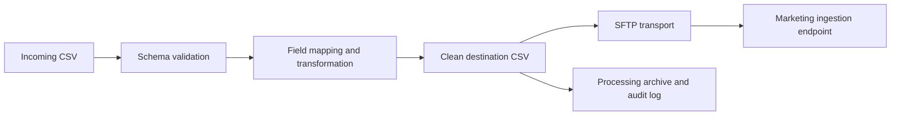

# Klaviyo SFTP Data Pipeline

A file-processing pipeline that transforms incoming customer records into an agreed marketing schema and delivers the output through secure file transfer.

## Problem solved

Source exports rarely match a destination platform's field requirements. Manual reshaping creates inconsistent columns, formatting errors, and delivery delays. This pipeline standardizes names, contact fields, mappings, output naming, and secure delivery in one repeatable flow.

## Architecture

## Technology

Python · pandas · Paramiko · SFTP · JSON field mapping · Structured logging · Environment-based configuration

## Engineering highlights

- Normalizes source columns through a versioned mapping definition.
- Splits and cleans customer name fields consistently.
- Separates incoming, processed, and failed records.
- Uses key-based SFTP authentication outside the repository.
- Logs pipeline stages without recording secret values.

## Documentation

- [Architecture](docs/architecture.md)
- [Transformation model](docs/transformation.md)
- [Security](docs/security.md)

> Private keys, PPK files, customer records, hostnames, usernames, and client-specific source code are excluded.
